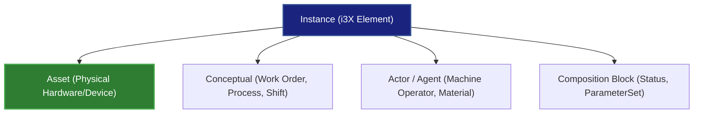
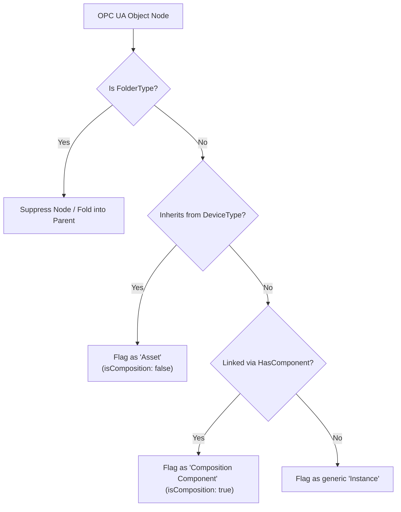

# Understanding Instances vs. Assets in the i3X UA Bridge

This document explains the semantic transition in the `node-i3x` bridge from the legacy **Asset** terminology to the standard i3X **Instance** terminology, and details the heuristic used to automatically distinguish physical hardware devices (Assets) from conceptual entities or structural components (Compositions).

---

## 1. Conceptual Split: "Instance" vs. "Asset"

In the i3X specification, **"Instance"** is the base, generic class representing any stateful, modeled entity in the Unified Namespace (UNS). **"Asset"** is a specialized sub-class reserved specifically for physical, tangible equipment and hardware.

All **Assets** are **Instances**, but not all **Instances** are **Assets**:



*   **Instance**: Represents *any* mapped OPC UA Object in the system (e.g., machine operators, shifts, physical machines, logical processes).
*   **Asset**: A specific semantic category representing physical devices or machinery (e.g., a pump, a motor, a CNC machine).
*   **Composition Block**: Internal nested structures belonging to an enclosing Instance/Asset (e.g., status blocks, parameter sets), mapped with `isComposition: true`.

---

## 2. Automatic Classification Heuristic

To automatically determine how each node in the address space should be treated, the bridge evaluates the following logical flowchart:



### Heuristic Steps

#### Step A: Filter out pure organizational folders
- **Check**: If the `typeDefinition` is `FolderType` (or standard system folder containers like `DeviceSet`, `Objects`, or `ObjectsFolder`), the node is suppressed and its children are flattened/folded into the parent.

#### Step B: Identify Physical Assets
- **Check**: Does the node's `typeDefinition` (or any of its super-types in the type ancestry) derive from **`DeviceType`** (OPC UA DI / Devices spec: `ns=0;i=5002`) or **`MachineryItemType`** (OPC UA for Machinery)?
- **Result**: Yes $\rightarrow$ This is a first-class **Asset** (`isComposition: false`). It serves as a primary node in the physical equipment hierarchy.

#### Step C: Identify Composition Blocks
- **Check**: If the node is linked to its parent via a **`HasComponent`** reference type (or resides within standard nested structures like `ParameterSet` or `MethodSet` on a device).
- **Result**: Yes $\rightarrow$ This is a **Composition Block** (`isComposition: true`). It represents functional internal subsets of an enclosing Instance or Asset rather than a separate independent hierarchy.

#### Step D: Identify Generic Instances
- **Check**: If the node does not derive from a physical device type, is not nested via `HasComponent`, and represents other independent logical concepts (e.g., an Operator, a Job, a Shift).
- **Result**: Yes $\rightarrow$ This is a generic **Instance** (`isComposition: false`), allowing modeling of non-hardware elements in the UNS.

---

## 3. Implementation Strategy

By loading type definitions from `dataSource.getObjectTypes()`, the bridge can construct a parent-type ancestry map. A `TypeResolver` can recursively check base type hierarchies at runtime:

```typescript
export class TypeResolver {
  private baseTypes = new Map<string, string>(); // childType -> parentType

  constructor(types: ObjectTypeInfo[]) {
    for (const t of types) {
      if (t.parentSourceNodeId) {
        this.baseTypes.set(t.sourceNodeId, t.parentSourceNodeId);
      }
    }
  }

  /** Recursively check if a type definition derives from a specific target type */
  derivesFrom(typeId: string, targetBaseTypeId: string): boolean {
    let current: string | undefined = typeId;
    while (current) {
      if (current === targetBaseTypeId) return true;
      current = this.baseTypes.get(current);
    }
    return false;
  }
}
```

Evaluating `typeResolver.derivesFrom(node.typeDefinition, 'ns=0;i=5002')` lets the bridge confidently classify incoming OPC UA objects as physical hardware assets or generic instances dynamically.
